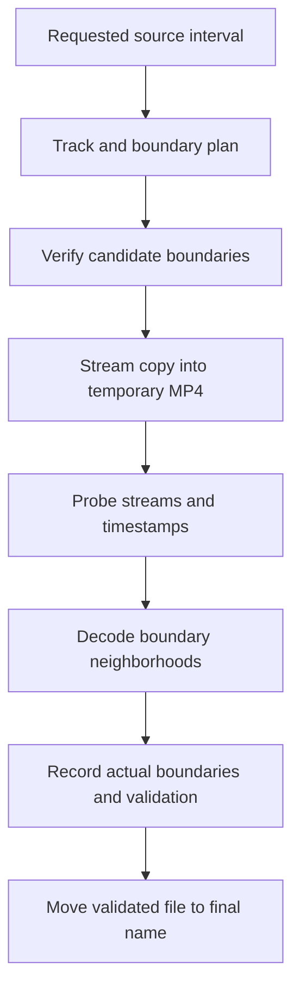
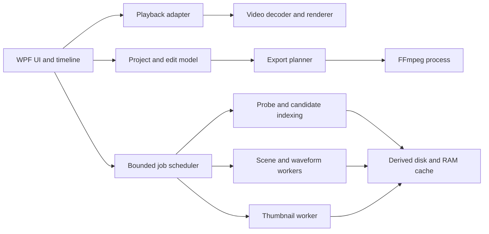

# vidsc: large-video navigation and stream-copy trimming on .NET 10

Research date: **14 October 2026**. Target hardware supplied by the user: **GeForce RTX 4070 Ti, 12 GB VRAM; 64 GB system RAM**. Project: `projects/vidsc`.

This is an implementation-oriented research report based on primary documentation, upstream repositories and release notes. Two user-supplied files were inspected read-only, including metadata, short packet/header windows and a two-second CUDA decode/scaling smoke test. **No desktop playback engine, completed export or sustained performance claim has been benchmarked.** Recommendations, budgets and acceptance targets below are engineering proposals, not measured results. Links were consulted on the research date; moving documentation and release pages may subsequently change.

## 1. Recommendation

Start with **C# / .NET 10 / WPF, x64**, and evaluate **Flyleaf as the first playback engine**. Use a separately packaged **FFmpeg + ffprobe command-line bundle** for inspection, exports and background utilities. Integrate **PySceneDetect as an optional local worker** for richer scene detection. Add a GPU-assisted FFmpeg analysis path where it delivers a measured benefit.

The proposed division of work is:

| Responsibility | Initial choice | Reason for this project |
| --- | --- | --- |
| Window, timeline, keyboard navigation, segment editor | WPF on .NET 10 | Windows desktop scope, custom controls and straightforward C# integration |
| Playback and accurate inspection | Flyleaf, subject to a prototype gate | Existing .NET/WPF integration, DirectX video path and frame-navigation features |
| Alternative playback engine | libmpv | Strong reference implementation for seeking and GPU playback; more integration work |
| Metadata and candidate keyframe discovery | ffprobe, progressively and with caching | Keeps initial integration small and independently testable |
| MP4 trimming | FFmpeg stream copy | Copies selected encoded streams into a new container |
| Optional accurate cuts | Separate smart-render worker, gated by codec-specific validation | Re-encode affected boundary regions and copy a compatible interior |
| Scene proposals | PySceneDetect adaptive/content/threshold detectors | Useful algorithms without writing a detector from scratch |
| GPU-assisted sequential analysis | FFmpeg NVDEC/CUDA scaling followed by a small CPU analysis image | Avoids downloading full-resolution frames for simple metrics |
| Persistent edit project | Small versioned JSON document | Holds selections and source identity, rather than video data |
| Derived media cache | Files plus a compact index | Thumbnails, waveform levels and analysis results can be regenerated |

**The application's correctness contract should be more important than its engine choice:** show the requested edit separately from the actual export boundaries, verify the produced clip, and never silently re-encode in stream-copy mode.

.NET 10 is an LTS release; Microsoft's current support policy lists support through November 2028. WPF continues to receive updates in .NET 10, including improvements to its Fluent styling. These establish a viable platform, not a built-in professional video engine. Sources: [Microsoft .NET support policy](https://dotnet.microsoft.com/en-us/platform/support/policy), [WPF changes in .NET 10](https://learn.microsoft.com/en-us/dotnet/desktop/wpf/whats-new/net100).

### Confirmed workload and remaining assumptions

The user confirmed **Windows only** and **optional accurate cutting with boundary re-encoding**, alongside strict stream-copy mode. Typical material is AVC/H.264 or HEVC encoded with NVIDIA or x265, usually 40–60 minutes, 1920 × 1080 or 1280 × 720, with portrait variants such as 1080 × 1920. Occasional QuickTime `.mov` files are also required. MOV/QuickTime denotes a container family, so its actual video/audio codecs must be inspected.

The provided examples add **MKV input** and a **122-minute, 9.56 GB source** to the acceptance corpus. The MP4 example is HEVC Main10 at 24000/1001 FPS with open GOP and B-frames. Section 18 records verified observations. Assume completed local files and one primary video stream initially; CPU, storage type, MOV codec profiles and final distribution/license remain unknown. AV1/4K/60 FPS are secondary robustness tests, rather than the core workload.

## 2. What makes a large clip difficult

File size alone is a poor predictor of editing responsiveness. The important variables are:

| Variable | Consequence | Proposed response |
| --- | --- | --- |
| Long GOP interval | An exact seek may require decoding many preceding frames | Fast coarse seeking during dragging; exact seek when settled |
| Codec/profile/chroma unsupported by GPU | Decode falls back to CPU | Detect and display the actual decode path |
| High resolution / high FPS | More decode, processing and presentation work | GPU surfaces and bounded queues |
| Variable frame rate | Frame index multiplied by nominal FPS gives wrong times | Use presentation timestamps |
| B-frame reordering / open GOP | Display order differs from decode order; cuts may depend on omitted frames | Inspect candidate boundaries and validate exports |
| Slow HDD, network or removable storage | Random reads and simultaneous workers compete | Limit concurrent jobs; cache derived data locally |
| Large MP4 sample tables / unusual edit lists | Opening and time normalization become more complex | Independent metadata loading; explicit timeline mapping |
| Many audio/subtitle/data tracks | Export compatibility and alignment need individual checks | Explicit track selection |
| HDR / rotation / anamorphic video | A simple bitmap path can display misleading images | Preserve and apply relevant display metadata |

Inference for vidsc: improve locality, scheduling and seeking behavior before attempting to fill available RAM. A 100 GB file need not be loaded into memory to preview it or copy a ten-minute segment.

## 3. Desktop framework comparison

These are project-specific judgments rather than benchmark rankings.

| Framework | Advantages for vidsc | Main concern | Recommendation |
| --- | --- | --- | --- |
| WPF | Established C#/XAML desktop UI; custom drawing; existing video hosts | Native video surfaces need deliberate composition and focus handling | First choice under Windows-only assumptions |
| WinUI 3 / Windows App SDK | Modern Windows presentation and composition APIs | Different hosting/deployment work; does not itself solve media seeking | Choose if its composition/UI benefits are a concrete requirement |
| Avalonia | Windows/Linux/macOS UI support | Playback surfaces and hardware paths still need platform integration | Choose if cross-platform delivery is confirmed |
| WinForms | Simple native window hosting | More work for a rich zoomable timeline and styling | Useful prototype host, less attractive final UI |
| .NET MAUI | Shared UI across device families | Little benefit for this Windows-focused editor | Do not select without a mobile requirement |

Microsoft positions WinUI as its modern Windows native UI framework; Avalonia documents its supported desktop platforms. Neither statement establishes superior video-editing performance. Sources: [WinUI overview](https://learn.microsoft.com/en-us/windows/apps/get-started/), [Avalonia supported platforms](https://docs.avaloniaui.net/docs/supported-platforms).

### WPF rendering is separate from video decoding

WPF's hardware rendering tier concerns UI rendering. It does not certify NVDEC use, codec support or frame-accurate playback. `D3DImage` hosts Direct3D content through a Direct3D9-facing interop mechanism; it should not be treated as a generic Direct3D11 texture sink. A custom D3D11-to-WPF bridge introduces surface-sharing, synchronization and lifecycle work. Sources: [WPF hardware rendering](https://learn.microsoft.com/en-us/dotnet/desktop/wpf/advanced/optimizing-performance-taking-advantage-of-hardware), [hosting Direct3D9 content in WPF](https://learn.microsoft.com/en-us/dotnet/desktop/wpf/advanced/walkthrough-hosting-direct3d9-content-in-wpf), [D3DImage](https://learn.microsoft.com/en-us/dotnet/api/system.windows.interop.d3dimage).

Proposed layout: put the transport controls and timeline beside/below the native video surface first. Treat overlays, popups, clipping, multiple monitors, DPI changes and fullscreen transitions as prototype requirements. Do not commit to a composition technique based only on a screenshot of a sample player.

## 4. Playback engine comparison

### Flyleaf: first candidate

Flyleaf advertises WPF/WinUI/WinForms hosting, FFmpeg decoding, DirectX rendering, video acceleration, zero-copy support, frame stepping and seeking by time/frame. Its release page currently identifies the v3.11.10–11 bundle as x64, .NET 10 and FFmpeg 9. These are upstream capabilities, not independently verified performance results. Sources: [Flyleaf repository](https://github.com/SuRGeoNix/Flyleaf), [Flyleaf releases](https://github.com/SuRGeoNix/Flyleaf/releases).

Project-specific reasons to try it first: less glue around a C# desktop host, existing device selection, and navigation features aligned with vidsc. Verify the meaning and accuracy of every seek/step operation with PTS-bearing fixtures. A frame-number API is not sufficient evidence of correct VFR handling.

Integration risks to resolve in the prototype:

- Decoder surfaces may be owned by the engine; an arbitrary long-lived GPU frame cache must not exhaust its pool.
- Export tools are independent of the player. A playback bundle can be deliberately minimal and may omit encoders needed for future proxy generation.
- Pin the Flyleaf package, its ABI bindings and its recommended native libraries together. A newer unrelated FFmpeg DLL is not automatically compatible.
- Check memory after repeated open/seek/close cycles, and verify disposal, device changes and concurrent seeking. Upstream release notes contain fixes in these areas.

Sources for the last two integration observations: [Flyleaf release history and package contents](https://github.com/SuRGeoNix/Flyleaf/releases), [Flyleaf documentation](https://github.com/SuRGeoNix/Flyleaf/wiki).

### libmpv: strongest alternative to prototype

The stable manual documents D3D11VA hardware decode and precise seeking; it also distinguishes hardware paths that copy frames back into system RAM. Exact seeking decodes from a preceding seek point. Reverse playback has limitations and is slower than forward playback. Source: [mpv stable manual](https://mpv.io/manual/stable/).

libmpv supports native window embedding via `wid`; upstream supplies a C# example. Its render API currently documents OpenGL and software backends, so libmpv must not be described as exposing a ready-made D3D11 render API. WPF plus `HwndHost` is a plausible Windows integration route, with overlay/focus constraints to test. Sources: [official embedding examples](https://github.com/mpv-player/mpv-examples/blob/master/libmpv/README.md), [render API header](https://github.com/mpv-player/mpv/blob/master/include/mpv/render.h).

Choose libmpv if the Flyleaf experiment fails on navigation accuracy, device stability or relevant content. Keep a small player adapter around the selected engine; do not implement and ship multiple engines preemptively.

### LibVLCSharp: good general playback candidate

LibVLCSharp has a WPF package and hardware-decoding controls. Its WPF documentation explicitly discusses the airspace problem and an overlay workaround. Its `NextFrame()` API is qualified with “if supported”; this is not an editor-grade guarantee for every source. Sources: [LibVLCSharp repository](https://github.com/videolan/libvlcsharp), [WPF hosting caveats](https://docs.videolan.me/libvlcsharp/docs/getting_started.html), [MediaPlayer API](https://docs.videolan.me/libvlcsharp/api/LibVLCSharp.Shared.MediaPlayer.html).

Assessment: use it if broad playback integration proves more valuable than the precision and backward-inspection requirements. For this task, prototype Flyleaf and compare libmpv only if necessary.

### Native Media Foundation or direct FFmpeg/Direct3D

Media Foundation supports D3D11 video decoding, but device-manager, transform and presentation integration still need implementation. It is an alternative when the Windows codec pipeline is intentionally preferred. Source: [D3D11 decoding in Media Foundation](https://learn.microsoft.com/en-us/windows/desktop/medfound/supporting-direct3d-11-video-decoding-in-media-foundation).

FFmpeg.AutoGen provides unsafe generated C# bindings; Vortice.Windows provides DirectX bindings. Neither is a complete video player. Building on them means owning demuxing, decoder lifecycle, audio timing, rendering and frame queues. Sources: [FFmpeg.AutoGen](https://github.com/Ruslan-B/FFmpeg.AutoGen), [Vortice.Windows](https://github.com/amerkoleci/Vortice.Windows).

Recommendation: reserve direct native integration for a demonstrated limitation, such as efficient MP4 index extraction or a custom analysis worker. Do not start by writing a playback engine.

## 5. What the RTX 4070 Ti can accelerate

The NVIDIA matrix identifies the **RTX 4070 Ti, not the Ti Super**, as Ada Lovelace, with **one NVDEC engine and two eighth-generation NVENC engines**. Relevant hardware decode capabilities are:

| Source format | RTX 4070 Ti hardware decode |
| --- | --- |
| H.264 4:2:0, 8-bit | Supported |
| H.264 4:2:0, 10-bit | Not supported |
| H.264 4:2:2 | Not supported |
| HEVC 4:2:0, 8/10/12-bit | Supported by the matrix; software/API path must also support it |
| HEVC 4:2:2 | Not supported |
| HEVC 4:4:4, 8/10/12-bit | Supported by the matrix; verify the chosen backend |
| AV1 Main 4:2:0, 8/10-bit | Supported |

H.264, HEVC and AV1 encoding support is useful for optional proxies or re-encoded exports. Do not infer support from codec name alone: inspect profile, chroma, bit depth, dimensions and the selected API. Source: [NVIDIA encode/decode support matrix](https://developer.nvidia.com/video-encode-decode-support-matrix).

NVDEC and NVENC are dedicated hardware engines, distinct from the graphics/compute engine. CUDA can handle processing around them. Runtime capability queries are preferable to hard-coded assumptions. Sources: [NVDEC programming guide](https://docs.nvidia.com/video-technologies/video-codec-sdk/13.0/nvdec-video-decoder-api-prog-guide/index.html), [NVENC application note](https://docs.nvidia.com/video-technologies/video-codec-sdk/13.0/nvenc-application-note/index.html).

### Proposed GPU policy

1. Prefer a hardware decode + GPU presentation path for supported source profiles. On Windows, evaluate D3D11VA within the playback engine first.
2. Keep decoded playback frames on GPU surfaces where the engine supports it. Avoid full-resolution CPU bitmap round trips for each displayed frame.
3. Use GPU scaling before readback for thumbnail or scene-analysis images when that path is demonstrably faster.
4. Give interactive playback priority over sequential analysis and proxy generation. More decode sessions still share hardware throughput and memory bandwidth.
5. Permit a visible CPU fallback for unsupported content, with an optional proxy when needed. A proxy must retain a mapping to source timestamps.
6. Show adapter, actual decoder, software fallback reason, queue depth and dropped frames in diagnostics.

**Stream-copy export does not decode or encode the selected video. NVENC and extra VRAM cannot turn it into a faster GPU encoding job.** Its bottlenecks are reads, writes, demuxing and muxing. Architectural inference from the [FFmpeg stream-copy model](https://www.ffmpeg.org/ffmpeg.html).

NVENC is still useful if the user chooses a workflow that permits re-encoding. Such outputs must carry a different mode label from strict stream copy.

## 6. Using 64 GB RAM and 12 GB VRAM productively

### Memory arithmetic

The following are calculations for tightly packed images, excluding alignment, decoder references, extra surfaces, object overhead and driver allocations:

| 3840 × 2160 frame format | Formula | Bytes/frame | MiB/frame |
| --- | --- | ---: | ---: |
| NV12, 8-bit 4:2:0 | width × height × 1.5 | 12,441,600 | 11.87 |
| P010, 10-bit 4:2:0 in 16-bit storage | width × height × 3 | 24,883,200 | 23.73 |
| BGRA8 | width × height × 4 | 33,177,600 | 31.64 |

At 4K60, five seconds of BGRA8 is approximately **9.27 GiB**. One hour is approximately **6.52 TiB**. A CPU readback of BGRA8 at 60 FPS moves about **1.85 GiB/s**, before subsequent uploads or copies. Large raw-frame caches are therefore a poor default even on this machine.

More economical caches:

- A two-hour timeline with one 384 × 216 BGRA thumbnail every two seconds still uses about **1.11 GiB** if all 3,600 thumbnails are decoded simultaneously. Store compressed images on disk and decode the visible neighborhood.
- A hypothetical packed 48-byte frame-index entry costs about **29.7 MiB** for three hours at 60 FPS. Actual implementations differ; per-frame managed objects and strings can cost far more.
- A short cache of reduced-resolution inspection frames can improve backward stepping without retaining whole full-resolution GOPs.

### Starting budgets to test

These are tunable upper budgets, not reservations or requirements to allocate memory:

| Resource | Initial proposal |
| --- | --- |
| Playback decoder/render queues | Engine-managed and bounded; tune from measurements |
| Compressed packet look-ahead | 256 MiB–1 GiB only if engine controls and workload justify it |
| Decoded visible timeline thumbnails | 128–512 MiB |
| Reduced-resolution inspection cache | 0.5–2 GiB, reclaimable |
| Indices, waveform levels, scene metrics | Prefer compact storage; normally much smaller than frame data |
| Total application RAM working target | Start around 4–8 GiB; allow a measured 12–16 GiB performance profile |
| GPU usage | Start by measuring ordinary playback; add only a small reclaimable cache within the current DXGI budget |
| Derived disk cache | Configurable, initially 10–30 GiB; evict least recently used artifacts |

Keep system memory available for the OS, storage cache and other applications. Windows already caches file data; an application copy of an entire source can duplicate that benefit. Memory mapping is useful for compact indices or selective file access, but does not make compressed video randomly decodable. Sources: [Windows file caching](https://learn.microsoft.com/en-us/windows/win32/fileio/file-caching), [.NET memory-mapped files](https://learn.microsoft.com/en-us/dotnet/standard/io/memory-mapped-files).

For the confirmed 1080p/24 FPS workload, start with a lower **2–4 GiB normal application target** and increase only for measured cache benefits. A 1920 × 1080 BGRA8 frame is about 7.91 MiB; five seconds at 24 FPS is about 0.927 GiB. One 250-frame GOP from the supplied HEVC file would occupy about **1.45 GiB in P010** or **1.93 GiB in BGRA8**, excluding decoder overhead. Cache reduced inspection images when possible and leave full-resolution decoder references under engine control. The machine's 64 GB RAM provides headroom, not an allocation target.

DXGI exposes a fluctuating video-memory budget and usage through `IDXGIAdapter3`. Use the available budget rather than treating all 12 GB as application-owned space. Source: [DXGI video memory budget tracking](https://learn.microsoft.com/en-us/windows/win32/direct3ddxgi/dxgi-1-4-improvements).

For managed buffers, pool/reuse only where profiling shows allocation pressure. Large arrays go on the large object heap, so allocating a fresh full-resolution array on every frame is especially unattractive. Source: [.NET large object heap](https://learn.microsoft.com/en-us/dotnet/standard/garbage-collection/large-object-heap).

## 7. Time, frames and precise navigation

Use the source stream's **integer PTS + rational time base** as the authoritative representation. Store DTS where decoding order matters. Derive seconds or `TimeSpan` for display, rather than using a floating-point slider value as the export contract.

For an example time base `1/90000`, PTS `900000` corresponds to ten seconds. A source frame index, normalized display time and MP4 packet position are different coordinates.

Proposed timeline rules:

- Preserve original stream timestamps and the mapping to the application's zero-based timeline.
- Determine normalization from actual container/stream timing; do not independently zero video and audio and thereby remove their relative offset.
- Treat a segment as `[start, end)`. Persist requested boundaries, selected candidate boundaries and measured output boundaries independently.
- Respect edit lists, negative start timestamps, audio priming and decoder reordering in fixtures.
- For VFR, find the preceding/following displayed frame using timestamps. A nominal `FPS` field can be shown as metadata; it is not a universal frame clock.

### Interaction proposal

| Interaction | Behavior |
| --- | --- |
| Drag the playhead | Coalesce events; approximate seek and cached thumbnails while moving |
| Release the playhead | Perform an exact seek and show the actual displayed timestamp |
| Step forward/backward one frame | Operate on the source presentation sequence |
| Previous/next keyframe | Jump to indexed candidates; distinguish candidate from verified export boundary |
| Previous/next scene | Jump to analysis markers without treating them as safe cuts |
| Set in/out | Keep both the user's selection and export-plan snap result |
| Zoom timeline | Request only thumbnails and markers relevant to the visible interval |

Suggested starting debounce interval: 40–80 ms during dragging, then an exact request on release. Use request generations so stale results cannot replace a newer seek. These values require usability testing.

Reverse inspection usually involves decoding forward from an earlier access point and using the resulting frames in reverse presentation order. Cache a small neighborhood when the engine allows it. Validate engine-native backward stepping first; implement extra caching only if it is inadequate. The cost of exact seek is documented by the [mpv manual](https://mpv.io/manual/stable/); the cache and scheduling policy here is a vidsc proposal.

## 8. Lossless MP4 trimming: the real contract

### Stream copy and independently decodable starts

Stream copy preserves encoded media without a decode/re-encode cycle. The MP4 is remuxed: its bytes, metadata layout, timestamps and file hash can change even when the media has not been re-encoded. FFmpeg input seeking normally goes to an earlier seek point; with stream copy, the intermediate encoded data is not removed by an accurate-seek decode pass. Source: [FFmpeg documentation](https://www.ffmpeg.org/ffmpeg.html).

An I-picture is not synonymous with a clean random-access point. x265 explicitly allows non-IDR I-slices with open GOP. A demuxer's keyframe flag is therefore a **candidate signal**, not a universal proof of an independently playable clip. Source: [x265 GOP options](https://x265.readthedocs.io/en/master/cli.html#slice-decision-options).

Recommended initial policy:

1. Discover candidate access points from packet/index information.
2. For supported source families, establish how packet flags correspond to clean random access. Prefer verified closed-GOP/IDR starts in the first implementation.
3. Inspect uncertain H.264/HEVC headers around the boundary and decode a trial export from its own beginning. HEVC CRA and leading pictures need a codec-aware policy; AV1 needs its own random-access/frame-header handling.
4. Label unverified candidates explicitly. Do not advertise every `pict_type=I` as safe.
5. If no acceptable point exists, offer another boundary or reject strict export for that selection.

FFmpeg's `trace_headers` bitstream filter can help inspect encoded headers during development; it is a diagnostic aid, not a complete export-safety classifier. Source: [FFmpeg bitstream filters](https://ffmpeg.org/ffmpeg-bitstream-filters.html#trace_005fheaders).

For this user's final supported HEVC workflow, an IDR-only classifier is insufficient: the representative MP4 contains a CRA at the inspected access point. CRA/leading-picture handling must therefore pass the export prototype gate, rather than remaining an indefinitely deferred feature. An initial IDR-only spike is useful for establishing correctness on AVC, but would not satisfy the full confirmed workload.

### End boundaries are not simply the same rule as starts

An output start must have the references and headers needed to decode independently. At the end, retained frames must still have their required references; B-frame reorder and cross-boundary dependencies complicate a simple PTS cutoff. Snapping the end to a GOP boundary is a useful conservative policy, but should not be presented as a universal mathematical requirement that every end frame be a keyframe.

For the MVP, offer complete validated GOP ranges where the source structure supports them, then measure the actual final displayed frame. More permissive end cuts should be enabled only for cases covered by fixtures and validation. Do not assume that `-t` alone implements an exact half-open frame interval for every compressed stream.

### Scene changes and encoded access points are different

For a scene marker at 12.400 seconds with safe candidates at 12.000 and 14.000:

| Export choice | Meaning |
| --- | --- |
| Expand selection | Include extra material before/after to preserve the intended scene |
| Contract selection | Remove extra material but potentially omit part of the intended scene |
| Nearest candidate | Minimize displacement; can both add and omit content |
| Exact boundary with re-encoding | A different export mode requiring explicit user choice |

Show the delta in milliseconds and frames where a frame mapping exists. A detected visual transition cannot create a new encoded keyframe in strict stream-copy mode.

LosslessCut's own troubleshooting documents inaccurate starts, track-dependent failures and experimental smart-cut limitations. That is useful evidence that export validation is needed even in an established tool. Source: [LosslessCut known limitations](https://github.com/mifi/lossless-cut/blob/master/docs/troubleshooting.md).

### Audio and additional tracks

Video and audio use different packet boundaries. A video access point is not necessarily an audio boundary, and compressed audio may need priming or overlap. Inspect actual audio packet timing instead of promising sample-exact cuts while copying every stream.

Proposed strict-mode behavior:

- Map the selected video/audio/subtitle tracks explicitly.
- Preserve their timing relationship and report the measured leading/trailing audio behavior.
- Support multiple audio tracks from the start of export planning, even if the first UI defaults to one.
- If a selected track is incompatible with MP4, show the incompatibility and let the user omit it or choose a different output policy.
- Never silently convert subtitles, resample audio or change the video codec in strict mode.
- Preserve track language/disposition and relevant color/rotation metadata; verify what the chosen muxer actually retains.
- DRM/encrypted or incomplete growing sources are outside the proposed first-version contract.

### Optional precise cuts with boundary re-encoding

This mode is confirmed as part of the intended application. Give it an explicit label such as **Accurate cut — boundaries re-encoded**. It preserves the copied interior's quality but does not promise bit-identical boundary frames.

Proposed plan for an interval `[A, B)`:

1. Decode from the necessary earlier access point to recover frames at A.
2. Re-encode the opening region from A to a **verified compatible splice point**, not merely the next packet carrying a key flag.
3. Copy the independent interior compressed ranges.
4. Decode enough context and re-encode the closing region up to B, where source dependencies make a simple packet cutoff unsuitable.
5. Assemble a valid timestamped output, preserving the chosen video representation and applying an explicit audio/subtitle policy.
6. Validate both joins, frame sequence, first/last frames and audio timing. Show which regions were re-encoded.

If both edits fall within a single dependency region, the whole selected short segment may need re-encoding. Open GOP can expand the affected region; the UI must report that before export. If compatible splicing cannot be established, disable boundary-only export for that case and offer a separately selected full transcode. Do not silently turn a boundary-only operation into a full-file encode.

The engineering difficulty is **splicing**, not issuing an NVENC encode command. Matching codec, dimensions and nominal bitrate does not ensure matching VPS/SPS/PPS, codec configuration, bit depth, color information, reorder model or timestamps. HEVC Main10 from x265 must remain Main10 if that is the requested representation; an 8-bit boundary would violate it. NVENC generates its own sequence parameters, which its API exposes; this does not make them identical to the source encoder's configuration. Source: [NVENC sequence parameter handling](https://docs.nvidia.com/video-technologies/video-codec-sdk/13.1/nvenc-video-encoder-api-prog-guide/index.html).

FFmpeg's concat demuxer requires compatible streams and time bases, and its duration/timestamp handling can introduce gaps. A naive three-file concat is not a universal smart-render algorithm. Source: [FFmpeg concat demuxer](https://ffmpeg.org/ffmpeg-formats.html#concat).

Practical implementation research:

| Approach | Value | Decision |
| --- | --- | --- |
| Existing LosslessCut implementation | Demonstrates encoding an opening region and copying later media; contains source-specific handling | Read as implementation evidence; do not assume it solves exact ending or every HEVC source |
| `skeskinen/smartcut` worker | MIT project with H.264/HEVC handling, including CRA/RASL work in its history | Useful reference and test subject; upstream says development stopped in February 2026, so not a dependable maintained backend |
| vidsc-owned codec-aware worker | Can enforce and test the intended contract | Preferred long-term path if existing workers cannot pass the corpus; isolate from the WPF process |
| NVENC boundary encoding | Uses the available GPU for supported profiles | Evaluate as an encoder choice after splice correctness; do not promise universal x265/NVENC compatibility |

Sources: [LosslessCut export implementation](https://github.com/mifi/lossless-cut/blob/master/src/renderer/src/hooks/useFfmpegOperations.ts), [smartcut status and design](https://github.com/skeskinen/smartcut).

Keep two separate precision statements: **video frame accuracy** and **audio sample accuracy**. From the user's supplied metadata, AAC-LC uses 1024 samples at 48 kHz (about 21.333 ms per packet) and AC-3 uses 1536 samples at 48 kHz (32 ms). Copying those packets is not generally sample-exact at a requested video frame. Offer copied audio with measured limits first; sample-accurate audio may require a separate re-encoding/priming policy and additional validation.

## 9. Metadata and keyframe indexing at scale

Use a staged open:

1. Start playback and metadata discovery independently.
2. Obtain stream identities, codec/profile, pixel format, dimensions, time bases, duration estimates, start times and display metadata.
3. Index a small neighborhood around the current playhead.
4. Build the broader candidate map as a cancellable background task.
5. Generate visible thumbnails, then sparse overview thumbnails.
6. Run scene detection only when requested or through an explicit background-analysis preference.

`ffprobe -show_packets` avoids full video decoding, but a full-file run still traverses packets and can produce enormous text output. It is not a constant-time lookup of MP4 keyframe tables. `-skip_frame nokey -show_frames` is a decode-oriented inspection technique, not an equivalent cheap table reader.

Consume packet output incrementally, keep only needed fields and persist compact entries. JSON is useful for small metadata responses; line-oriented packet records are convenient for streaming a large scan. `-read_intervals` uses inexact seeks, so overlapping windows need deduplication and actual timestamp checks. Source: [ffprobe options and interval semantics](https://ffmpeg.org/ffprobe.html).

For conventional MP4, investigate reading the demuxer's available index through libavformat if a full packet walk makes the candidate map too slow. Its APIs include `avformat_index_get_entries_count` and timestamp-based access. An index entry timestamp is not automatically the displayed PTS, and completeness depends on the demuxer/source. Copy required values into owned storage; do not retain borrowed native pointers across calls. Source: [libavformat index APIs](https://ffmpeg.org/doxygen/trunk/group__lavf__misc.html).

Proposed cache identity: source path + file length + last-write time + a sampled content fingerprint + stream identity, followed by stronger validation for reused export plans. Include cache schema, tool version and analysis parameters. Invalidate on source changes. A short sampled hash improves cache identification but is not proof that an entire file is unchanged.

Do not index frames by decimal strings or allocate a UI object per packet. Use 64-bit file offsets and timestamp values. Store complete frame timing only when needed for navigation; store sparse candidates and scene markers independently.

## 10. Scene detection and useful tools

### PySceneDetect

PySceneDetect offers adaptive/content detectors for cuts and threshold detection for fades. Its scene manager performs decoding in a background thread, supports downscaling and can persist frame metrics for threshold tuning. Sources: [PySceneDetect CLI](https://www.scenedetect.com/docs/latest/cli.html), [scene manager API](https://www.scenedetect.com/docs/latest/api/scene_manager.html), [detector API](https://www.scenedetect.com/docs/latest/api/detectors.html).

The current upstream release is **v0.7.2**; the `latest` documentation resolved to **0.7.1** during this research, while `head` displayed 0.7.2. Pin a release and check its packaged help/schema rather than assuming those documentation aliases are synchronized. The 0.7.2 release also warns that frame numbers in its `save-keyframes` output are approximate for VFR. That command exports scene markers for external tools; it does not create independently decodable video keyframes. Source: [PySceneDetect v0.7.2 release](https://github.com/Breakthrough/PySceneDetect/releases/tag/v0.7.2).

Current backend documentation describes PTS-based VFR timing with OpenCV/PyAV and says MoviePy does not support VFR timing. Prefer PyAV for the reference worker, retain timestamp data, and verify against source PTS in fixtures. Do not convert old CSV frame counts using average FPS when timestamps are available. Source: [PySceneDetect backends](https://www.scenedetect.com/docs/latest/cli/backends.html).

A normal `opencv-python` package does not establish CUDA support; the package documentation identifies source builds as the path for additional modules such as CUDA. PySceneDetect must not be advertised as an automatically GPU-accelerated detector just because the machine has an NVIDIA card. Source: [OpenCV Python package documentation](https://pypi.org/project/opencv-python/).

Recommended worker contract: local executable/process, selected source and time interval, detector parameters, output directory, cancellation, version information, and parsed scene intervals/metrics. Keep Python out of the UI process. A portable release is worth evaluating before bundling an entire general-purpose Python environment. Upstream provides Windows distributions: [PySceneDetect repository](https://github.com/Breakthrough/PySceneDetect).

### GPU-assisted analysis without inventing GPU support

Recommended experimental flow:


This is a **hybrid pipeline**: GPU decode/scaling, CPU metrics. It can satisfy GPU use while avoiding the engineering cost of custom detector shaders. FFmpeg/NVIDIA document GPU decoding and CUDA scaling; their presence still depends on the selected build and driver. Source: [NVIDIA FFmpeg acceleration guide](https://docs.nvidia.com/video-technologies/video-codec-sdk/13.0/ffmpeg-with-nvidia-gpu/index.html).

A scaled proxy can alternatively feed PySceneDetect. If materializing a proxy, preserve timestamps or a trustworthy per-frame source mapping; forcing a constant frame rate can shift VFR detections. Include proxy-generation time and disk writes in performance comparisons.

Only implement custom D3D11/CUDA scene metrics if this hybrid path fails a measured requirement. Benchmark correctness as well as FPS: adaptive scene detection and a simple luma-difference detector are different algorithms, and changing scale or HDR treatment changes their scores.

### Useful tools to prioritize

| Tool | Value in vidsc | Processing policy |
| --- | --- | --- |
| Scene markers | Jump through long material quickly | Persist proposals independently from safe-cut candidates |
| Sparse thumbnails / hover preview | Navigate before all analysis completes | Visible region first; retain source time |
| Audio waveform | Locate speech, silence and events | Decode audio once; store multi-resolution peaks |
| Silence markers | Propose edit ranges | Configurable threshold; review before applying |
| Black-frame/black-interval markers | Identify gaps and transitions | CPU baseline; evaluate GPU decode/downscale |
| Freeze markers | Find stalled or duplicated material | Optional, because static scenes create false positives |
| Chapters / bookmarks | Fast manual navigation | Source metadata plus editable project markers |
| Track inspector | Explain MP4 export failures | Codec, language, disposition, offsets and compatibility |
| Batch export / segment naming | Reduce repetitive work | Deterministic naming, conflict handling and progress |
| Boundary preview | Check what the export includes | Play the verified boundary neighborhood |

FFmpeg supplies scene, silence, black and freeze detection filters; exact availability should be checked in the pinned build. Source: [FFmpeg filters](https://ffmpeg.org/ffmpeg-filters.html). The table prioritization is a product proposal.

## 11. Practical command templates

These are **starting points for a prototype**, not universal export recipes or tested commands. Paths refer to the preferred local bundle from the host tooling instructions; a delivered application should resolve its own packaged tools. Source/output names and times below are examples.

### Inspect metadata

```powershell
& 'C:\ffmpeg\bin\ffprobe.exe' -v error -show_format -show_streams -show_chapters -of json 'input.mp4'
```

### Inspect video packets around a boundary

```powershell
& 'C:\ffmpeg\bin\ffprobe.exe' -v error -select_streams v:0 -read_intervals '120%+10' -show_packets -show_entries 'packet=pts,dts,duration,pts_time,dts_time,pos,size,flags' -of 'compact=p=0:nk=0' 'input.mp4'
```

The seek can land earlier than 120 seconds and the duration is measured from the actual seek point. Interpret source time bases, retain packet positions and classify key flags as candidates. These templates use the [ffprobe documented interfaces](https://ffmpeg.org/ffprobe.html).

### Prototype a selected stream-copy segment

```powershell
& 'C:\ffmpeg\bin\ffmpeg.exe' -hide_banner -nostdin -n -ss 120.000 -i 'input.mp4' -t 30.000 -map 0:v:0 -map '0:a?' -c copy -map_metadata 0 -map_chapters -1 -progress pipe:1 -nostats 'clip.partial.mp4'
```

The example intentionally selects the first video plus optional audio tracks and drops chapters; the application must use its explicit track/chapter policy. `-n` prevents replacement. It does **not** prove that 120.000 or 150.000 seconds are the actual displayed boundaries. Use only after planning candidate boundaries and inspect the resulting file.

Do not globally add `-copyts`, `-start_at_zero` or `-avoid_negative_ts make_zero` as an assumed fix. Test a documented timestamp policy per supported source family and inspect A/V alignment. Source for option semantics: [FFmpeg command options](https://www.ffmpeg.org/ffmpeg.html).

For a locally consumed clip, `+faststart` is optional. It moves the MP4 index in another pass and can add noticeable I/O on a large export. Conventional MP4 normally needs finalization; fragmented MP4 tolerates interrupted writing better and can reduce muxer metadata memory, with a compatibility tradeoff. Source: [MP4 muxer documentation](https://ffmpeg.org/ffmpeg-formats.html#mov_002c-mp4_002c-ismv).

### Reference scene detection

```powershell
& '.\tools\scenedetect\scenedetect.exe' -i 'input.mp4' -b pyav -o '.\analysis' detect-adaptive list-scenes
```

This assumes the packaged distribution contains PyAV; confirm with its version/help output. Import results as scene proposals. Do not use an automatic split operation to bypass vidsc's export planner. Source: [PySceneDetect CLI](https://www.scenedetect.com/docs/latest/cli.html).

### Experimental GPU-assisted scene metrics

```powershell
& 'C:\ffmpeg\bin\ffmpeg.exe' -hide_banner -nostdin -loglevel error -hwaccel cuda -hwaccel_output_format cuda -i 'input.mp4' -map 0:v:0 -an -sn -dn -vf 'scale_cuda=640:-2:format=yuv420p,hwdownload,format=yuv420p,scdet=threshold=10,metadata=mode=print:file=-' -f null NUL
```

This downloads a small YUV image and runs CPU `scdet`. It requires compatible input, decoder, CUDA scaling and software formats. Treat 10-bit/HDR sources as a separate tested graph; reducing precision or using different tone mapping can change scene scores. `scale_cuda` does not perform YUV-to-RGB conversion. Source: [FFmpeg hardware/scdet filter documentation](https://ffmpeg.org/ffmpeg-filters.html).

Do not interpret a successful process launch or a listed `cuda` backend as proof that useful GPU processing occurred. Record the actual decode/filter path and compare wall-clock time against the CPU baseline.

## 12. Export verification and non-destructive editing

Proposed export lifecycle:



Keep sources read-only. Store edits as intervals, markers and decisions; export creates new media. A cancelled conventional MP4 may be incomplete, so use a temporary output name on the destination filesystem and promote it after validation. Do not overwrite a completed file without the user's selected conflict policy.

Smallest useful per-export checks:

1. Process exit code and successful finalization.
2. Expected streams/codecs and nonempty media, not merely a container duration.
3. Actual first/last video PTS and relevant audio timing.
4. Decode of the opening and closing neighborhoods, including reorder/drain behavior; inspect warnings.
5. Confirmation that effective start/end differences match what the UI communicates.

For the development corpus, additionally decode the entire short fixture and compare retained encoded packet payloads. ffprobe supports packet payload hashes; correlate them to the selected source packets rather than comparing complete MP4 file hashes. If a bitstream filter changes representation, account for that transformation instead of equating unequal raw packet hashes with re-encoding. Source: [ffprobe hashing](https://ffmpeg.org/ffprobe.html).

Boundary decode success alone is not proof of pixel identity: decoders can conceal corruption. Fixtures should include known visual frame IDs or reference frame hashes. The first iteration should fail conservatively when export behavior cannot be explained; it should never report an unverified clip as an exact cut.

## 13. Application structure and scheduling

Use one desktop application with a few explicit components, rather than a service fleet:



Suggested initial responsibilities, whether they become classes or small modules:

| Component | Contract |
| --- | --- |
| Playback adapter | Load, play/pause, approximate/exact seek, step, observed timestamp and diagnostics |
| Media inspector | Stream metadata, timing normalization and candidate index status |
| Edit model | Source identity, requested intervals, track selection, markers and undo/redo |
| Export planner | Chosen boundaries, snap deltas, uncertainty and effective stream mapping |
| Export runner | Execute/cancel, bounded logs, progress and temporary output |
| Validator | Actual timing, stream consistency and decode evidence |
| Analysis worker | Versioned scene/waveform/thumbnail results tied to source PTS |
| Cache manager | Budgets, invalidation, eviction and reconstructible artifacts |

Use the WPF dispatcher only for UI work. Perform native waits, probing and analysis off the UI thread, and coalesce result updates. Source: [WPF threading model](https://learn.microsoft.com/en-us/dotnet/desktop/wpf/advanced/threading-model).

A bounded `Channel<T>` is sufficient for producer/consumer backpressure; avoid unbounded frame queues. Suggested priority order: current playback/seek, visible thumbnails, export, then background analysis. Start with one sequential analysis job; increase concurrency only after measuring storage and decoder contention. Source for bounded-channel behavior: [.NET channels](https://learn.microsoft.com/en-us/dotnet/core/extensions/channels).

Virtualize scene/file lists and draw timeline markers in batches instead of creating a control for every frame. WPF UI virtualization and data virtualization are separate concerns; loading fewer visual items does not automatically reduce the data set. Source: [WPF control performance](https://learn.microsoft.com/en-us/dotnet/desktop/wpf/advanced/optimizing-performance-controls).

For CLI workers, use `ProcessStartInfo.ArgumentList`, no shell, redirected outputs read concurrently, and cancellation that terminates the job's process tree where appropriate. Keep logs bounded and preserve actionable errors. Source for argument construction: [ProcessStartInfo.ArgumentList](https://learn.microsoft.com/en-us/dotnet/api/system.diagnostics.processstartinfo.argumentlist?view=net-10.0).

Persist the edit document independently of disposable caches. Begin with JSON and files; introduce SQLite only if indexing/query needs justify it. No dependency is needed merely to store a few segment ranges.

## 14. Packaging, versions and license decisions

Observed upstream version baseline:

| Component | Observation on research date | Proposed handling |
| --- | --- | --- |
| .NET | 10 LTS | Use the supported .NET 10 patch at implementation time; pin SDK |
| FFmpeg | Official download page lists 9.0.2, released 18 September 2026 | Select and pin a Windows build with required capabilities |
| Flyleaf | Release page identifies v3.11.10–11 / .NET 10 / FFmpeg 9 | Pin managed packages and recommended playback-native bundle together |
| PySceneDetect | v0.7.2; `latest` docs still showed 0.7.1 | Pin executable and verify packaged commands/output schema |
| libmpv | Manual selector lists stable v0.41.0 | If chosen, pin binary, binding and matching API documentation |

Sources: [.NET policy](https://dotnet.microsoft.com/en-us/platform/support/policy), [FFmpeg downloads](https://ffmpeg.org/download.html), [Flyleaf releases](https://github.com/SuRGeoNix/Flyleaf/releases), [PySceneDetect release](https://github.com/Breakthrough/PySceneDetect/releases/tag/v0.7.2), [mpv manual selector](https://mpv.io/manual/).

The official FFmpeg site supplies source and links to third-party compiled builds. A packaged Windows build must be checked for architecture, DLL dependencies, decoders, hardware acceleration and required filters. Keep the player-native DLL bundle separate from CLI tools to prevent accidental ABI/library mixing. Include runtime DLLs unless a build is independently confirmed static.

License observations relevant to dependency selection:

- Flyleaf identifies LGPL-3.0. Its license and native dependencies need to be included in the distribution decision: [Flyleaf license](https://github.com/SuRGeoNix/Flyleaf/blob/master/LICENSE.txt).
- FFmpeg is primarily LGPL, with build options/components that can change the resulting license. Inspect the actual build, not the name of the executable: [FFmpeg license guidance](https://ffmpeg.org/legal.html).
- mpv defaults to GPL; upstream documents a mode excluding GPL-only files, with linked dependencies still affecting licensing: [mpv copyright/build notes](https://github.com/mpv-player/mpv/blob/master/Copyright).
- LibVLCSharp identifies LGPL-2.1; verify the native/plugin bundle as well: [LibVLCSharp repository](https://github.com/videolan/libvlcsharp).
- PySceneDetect identifies BSD-3-Clause; its Windows distribution includes other dependencies: [PySceneDetect repository](https://github.com/Breakthrough/PySceneDetect).

These observations identify work to complete before redistribution, not a legal conclusion that subprocess execution removes license obligations. Keep exact versions, build configurations, hashes and notices with the delivered bundle.

Packaging acceptance proposal: run from the delivered location with the development FFmpeg directory removed from effective PATH, probe a fixture, play it with the intended decode path and export it. A working developer installation does not establish that a package is self-contained.

## 15. Prototype and benchmark plan

### Required evaluation corpus

| Fixture family | What it resolves |
| --- | --- |
| H.264 8-bit 4:2:0, short closed GOP, AAC | Basic navigation and strict stream-copy baseline |
| Same with B-frames and long GOP | Seek cost, end behavior and boundary displacement |
| HEVC Main10 4:2:0, HDR and open GOP | GPU path, tone mapping, CRA/leading pictures |
| AV1 4:2:0 in MP4 | Playback and codec-specific random-access/export policy |
| H.264 10-bit / camera 4:2:2 | Honest CPU fallback and possible proxy workflow |
| VFR screen recording | Timestamp correctness and scene import |
| Multiple audio tracks, delayed audio, subtitles | Mapping, offsets and MP4 compatibility |
| Nonzero/negative starts, rotation, edit lists | Timeline normalization and metadata preservation |
| Fragmented MP4 / large sample table | Index completeness and open latency |
| Damaged/incomplete source and cancelled export | Actionable failures and cleanup |
| Long 20–100+ GB source on intended storage | Real I/O, memory growth and background contention |

Use small synthetic labeled fixtures for correctness and real large files for performance. Large sources can be generated/copied only in a later implementation/test task; this research did not create or modify media.

### Metrics to record

- Metadata latency and time to first visible frame, independently of full indexing.
- Median/p95 exact-seek latency: nearby, cross-GOP, random and backward.
- Displayed PTS accuracy and frame-step sequence against known frame labels.
- Dropped frames and A/V sync during a sustained representative playback run.
- Candidate-index progress, scan throughput and cold/warm cache behavior.
- CPU, RAM/commit, GPU video-decode/compute usage, VRAM and read/write throughput.
- Timeline-thumbnail hit rate and latency during rapid zoom/scroll.
- Scene-detection FPS **and** false/missed detections against labeled transitions.
- Export elapsed time, validation cost, actual boundaries and retained-payload evidence.
- Memory/resource growth after repeated source changes and cancelled tasks.

Compare CPU analysis against GPU decode/downscale + CPU metrics including transfer/setup time. Compare playback alone against playback with one background job. Distinguish cold OS cache from warm cache, and record CPU, disk model, driver, selected adapter and exact tool builds.

Provisional usability targets to negotiate after the corpus is known:

| Operation | Initial target, not a prediction |
| --- | --- |
| UI interaction while probing/analyzing | No sustained main-thread stalls |
| Cached hover/thumbnail response | Approximately 100 ms or less |
| Nearby warm exact seek on representative supported source | Aim for p95 below 300–500 ms; measure long-GOP exceptions |
| Playback | Source-rate playback with no sustained drops on the chosen reference material |
| Repeated open/close/cancel | Memory returns toward baseline; no accumulating devices/processes |
| Strict export | No hidden codec conversion; measured boundaries match the communicated plan |

### Implementation sequence

1. **Playback spike:** WPF + Flyleaf, a real source, hardware-path diagnostics, exact seek/steps and lifecycle checks. Compare libmpv if a material issue appears.
2. **Export spike:** staged metadata/candidate discovery, boundary planning and FFmpeg copy export with verification. This is the correctness gate before timeline polish.
3. **Navigation MVP:** zoomable timeline, sparse thumbnails, keyboard transport, in/out ranges, undo/redo and actual-boundary feedback.
4. **Tools:** scene proposals, waveform, black/silence markers and batch exports.
5. **Performance pass:** local inspection cache, GPU-assisted analysis and budget tuning based on traces.
6. **Distribution pass:** pinned self-contained tool bundles, notices and clean-location smoke tests.

Because boundary re-encoding is confirmed, follow the strict-export spike with a **separate smart-render correctness spike on the supplied x265 file**, before promising that mode in the UI. Begin with software encoding as a reference if needed, then compare NVENC for compatible supported cases. Full reverse playback, advanced HDR transformations and custom GPU detector kernels should follow measured requirements.

## 16. Decisions still needed

Confirmed: Windows-only; AVC/HEVC-focused 720p/1080p material, including portrait video; MP4/MKV/MOV input; strict copy plus optional accurate boundary re-encoding.

Remaining decisions:

1. CPU and source/cache/output storage: NVMe, SATA SSD, HDD or network?
2. Actual MOV codecs/profiles and whether HDR is common? Ten-bit HEVC alone does not establish HDR.
3. Preferred snapping: expand, contract or nearest, and acceptable scene-boundary displacement?
4. One source with many segments, a folder browser, or multi-source concatenation?
5. Which additional tracks and metadata must survive export, especially subtitles and chapters?
6. Is copied audio with packet-level cut limits acceptable in accurate-video mode, or is sample-exact audio required?
7. Personal local use or redistributed application, and intended application license?

These affect final engine, cache and export policies. They do not prevent the first two focused prototypes under the assumptions in section 1.

## 17. Research coverage and verification status

Covered: .NET/WPF viability; alternative desktop frameworks; four playback approaches; GPU codec limits; RAM/VRAM sizing; accurate navigation; MP4 stream-copy and boundary-re-encoding risks; progressive indexing; scene detection and GPU-assisted analysis; worker scheduling; export verification; packaging and an implementation test plan. The confirmed real sources were inspected as documented below.

Primary sources are linked beside the supported claims throughout the report. Upstream feature descriptions are deliberately distinguished from vidsc design proposals. No tutorial/blog benchmark has been treated as proof of performance on this machine.

Local checks performed for this report: confirmed the `vidsc` project directory was empty and the sandbox could run `rg`, `jq` and `pandoc`; verified FFmpeg/ffprobe identity; probed both sources; read short video-packet windows; inspected encoded headers; and ran short CUDA decode/scaling smoke tests. No source file was changed and no media output file was created. Desktop playback, sustained GPU throughput, stream-copy exports, smart-render joins and the complete scene-analysis command remain unverified.

## 18. User-supplied sources: read-only findings

### Source paths and probe identity

```text
D:\qbits\The.Death.of.Robin.Hood.2026.1080p.WEB-DL.DD5.1.H.264-ROBINHOODROBBED.mkv
D:\qbits\Game.of.Thrones.S01-S08.1080p.BluRay.x265-RARBG\Game.of.Thrones.S01.1080p.BluRay.x265-RARBG\Game.of.Thrones.S01E01.1080p.BluRay.x265-RARBG.mp4
```

Executed tools: `C:\ffmpeg\bin\ffmpeg.exe` and `C:\ffmpeg\bin\ffprobe.exe`, both reporting **N-121120-gc74181a04b-20250918**. This is the installed development snapshot, **not** the FFmpeg 9.0.2 release identified in online research. Its configuration includes `--enable-shared`, `--enable-gpl`, `--enable-version3`, `--enable-ffnvcodec` and `--enable-cuda-llvm`. It therefore needs adjacent native DLLs and must not be described as an LGPL-only static bundle.

### Metadata independently confirmed with ffprobe

| Property | AVC/MKV source | HEVC/MP4 source |
| --- | --- | --- |
| File length | 9,562,549,574 bytes (~8.91 GiB) | 1,032,027,703 bytes (~0.961 GiB) |
| Container duration reported by this ffprobe | 7313.152 s (~2 h 1 min 53 s) | 3697.152 s (~1 h 1 min 37 s) |
| Video | H.264 High, yuv420p | HEVC Main10, yuv420p10le, `hev1` |
| Visible dimensions | 1920 × 1038 | 1920 × 1080 |
| Frame rate | 24/1 | 24000/1001 |
| Video time base | 1/1000 | 1/24000 |
| Video start | 0 s | 0 s |
| Video duration from stream field | Not present in this probe result | 3697.151792 s |
| Audio | AC-3, 48 kHz, 5.1(side), English | AAC-LC, 48 kHz, 5.1, English |
| Audio time base | 1/1000 | 1/48000 |
| Subtitle | SubRip, Arabic | None |
| Chapters | Four | None |

The user-supplied MediaInfo output reports 3697.195 s at MP4 container level; this ffprobe reports 3697.152 s. Record both observations rather than treating one tool's rounded duration as the authoritative last frame. The x265 metadata contains `open-gop`, `keyint=250`, `bframes=4`, `b-pyramid` and `no-hdr10`; the probe did not supply color primaries/transfer metadata for that MP4. Ten-bit storage does not justify labeling it HDR.

### Candidate access points near 120 seconds

Method: `ffprobe -select_streams v:0 -read_intervals '120%+30' -show_packets`, retaining timestamp/position/flag fields and selecting packets carrying `K`. This reads a small window, not a complete-file keyframe map.

| Observation | AVC/MKV | HEVC/MP4 |
| --- | --- | --- |
| Packets in inspected window | 719 | 720 |
| First packet PTS | 119.667000 s | 119.202417 s |
| Last packet PTS encountered | 149.542000 s | 149.107292 s |
| Candidate PTS values | 119.667, 123.417, 126.917, 130.458, 133.792, 137.167, 140.542, 143.917, 146.000, 148.083 | 119.202417, 121.913458, 132.340542, 135.510375, 138.513375, 147.355542 |

The HEVC candidates at 121.913458 and 132.340542 are **10.427084 seconds apart**, consistent with 250 frames at 24000/1001 FPS. At the latter candidate, PTS is 132.340542 while DTS is 132.090292, approximately 250.25 ms apart. This directly demonstrates why decode order cannot substitute for display order. The first MKV packet in the window did not expose DTS, so missing values must remain missing rather than being replaced with zero.

### Encoded-header inspection

Method: short `-ss 120 ... -t 0.2 -map 0:v:0 -c:v copy -bsf:v trace_headers -f null NUL` runs. No video decode or media file write occurs in this inspection.

- AVC trace: SPS/PPS and **NAL type 5** slices at the opening access point, consistent with IDR. Eight IDR slice headers were encountered, consistent with the supplied eight-slice metadata; eight slices do not mean eight keyframes.
- HEVC trace: VPS/SPS/PPS and **NAL type 21** at the opening access point, which is CRA, not IDR. This short trace does not classify every access point or establish the absence of leading-picture complications elsewhere.

The numeric type interpretations were checked against upstream definitions: [FFmpeg H.264 NAL types](https://ffmpeg.org/doxygen/trunk/h264_8h_source.html), [FFmpeg HEVC NAL types](https://www.ffmpeg.org/doxygen/9.0/libavcodec_2hevc_2hevc_8h_source.html).

### CUDA decode/scaling smoke test

Method: request CUDA hardware decode, CUDA output frames and `scale_cuda=640:-2` for a two-second interval around 120 s, with video-only null output. Both FFmpeg runs exited **0**.

| Evidence from logs | AVC/MKV | HEVC/MP4 |
| --- | --- | --- |
| Decoder selected for requested CUDA path | h264 | hevc |
| Filter input frame format | cuda | cuda |
| GPU scaling | NV12, 1920 × 1038 → 640 × 346 | P010, 1920 × 1080 → 640 × 360 |
| Decoded frames reported, including seek/preroll | 59 | 73 |
| Decode errors reported | 0 | 0 |
| Frames passed to null output | 48 | 47 |

The output wrapper is `wrapped_avframe`; log wording such as “frames encoded” here does **not** mean NVENC recompressed a video. The results establish that a working CUDA decode/scaling path exists for these two sampled intervals. They do not establish sustained FPS, the identity of an explicitly selected adapter, D3D11VA behavior inside WPF, or full-file correctness. The full scene-metrics graph was not tested.

### Consequences for vidsc

1. Prioritize the supplied **HEVC Main10/open-GOP file** as the difficult navigation/splice fixture and the **AVC MKV** as the track/container-conversion fixture.
2. Support portrait orientation and nonstandard visible dimensions such as 1920 × 1038; preserve aspect ratio and display cropping.
3. Handle MKV input directly without requiring an entire initial remux just to navigate it.
4. The MKV's SubRip subtitle cannot simply be copied into a conventional MP4 subtitle track. Offer explicit omission, an external subtitle export, retention in MKV, or separately selected conversion to an MP4-supported format. Boundary-video re-encoding authorization does not imply silent subtitle conversion. Source: [FFmpeg discussion with muxer diagnostic](https://ffmpeg.org/pipermail/ffmpeg-user/2025-January/058992.html).
5. AC-3 can be represented by FFmpeg's MOV/MP4 muxer, but target-player support still needs testing; do not silently convert 5.1 audio to stereo AAC. Source: [FFmpeg MOV/MP4 muxer implementation](https://www.ffmpeg.org/doxygen/trunk/movenc_8c_source.html).
6. Clip chapters relative to the output interval and retain only relevant chapters, or explicitly drop them. Copying original chapter timestamps blindly is not a useful editing policy.
7. The supplied HEVC footer/index metadata suggests an end-located index. Local random access should remain possible without rewriting the source; `faststart` is an optional export/layout decision, not a prerequisite for editing.
